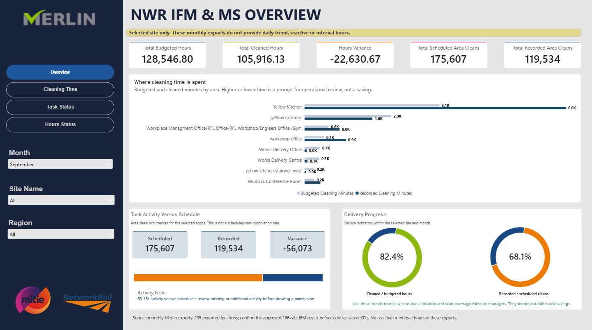
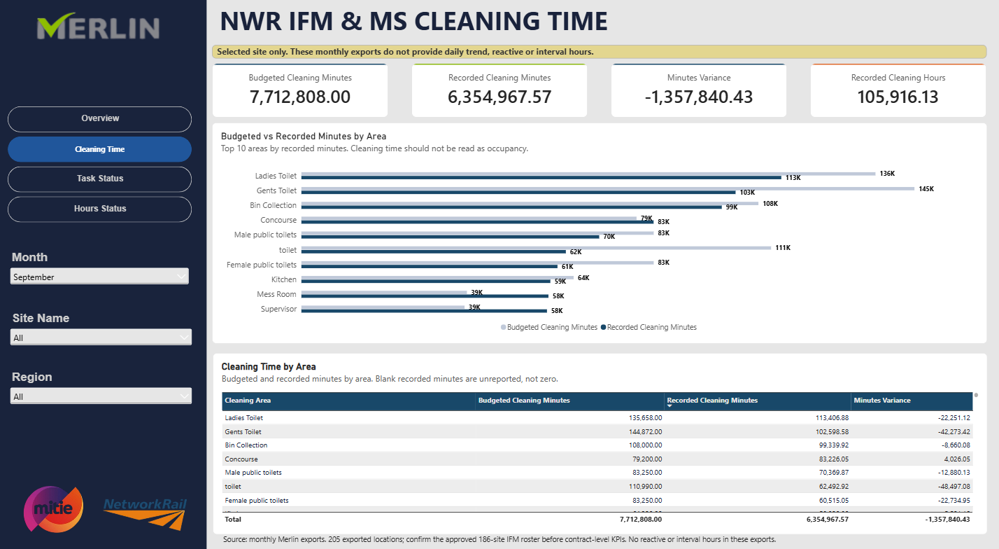
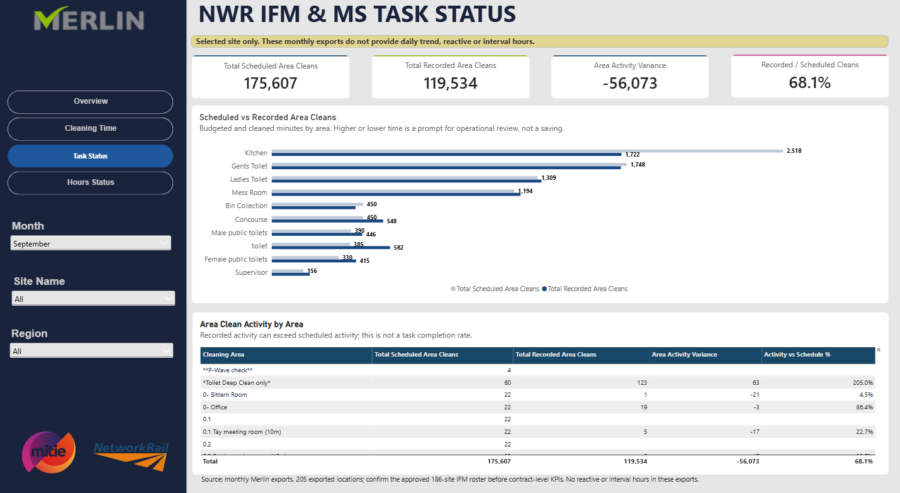
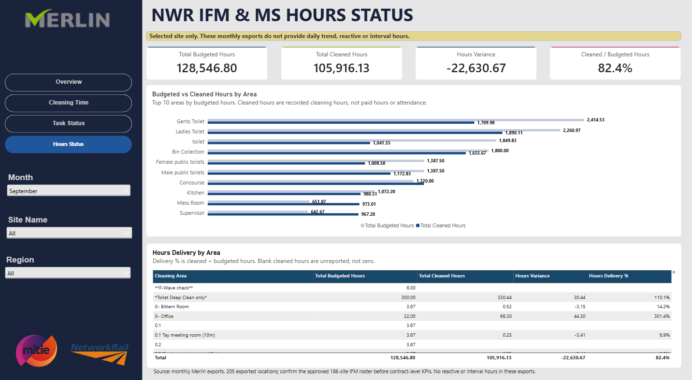

# Cleaning Operations Dashboard: IFM & Managed Services

**Tools:** Power BI, Power Query, DAX
**Domain:** Integrated facilities management, cleaning service delivery

A four-page Power BI dashboard that turns monthly cleaning-management exports into a clear view of cleaning time, task activity and hours delivery for a rail station site. I cleaned and combined 200+ exported locations in Power Query, wrote the DAX measures for variance and delivery %, and added Month, Site and Region filters with area-level charts and drill-down tables. Data-quality notes on every page keep the numbers from being misread.

## Headline numbers

| Report pages | Locations | Cleaned / budgeted hours | Recorded / scheduled cleans |
| --- | --- | --- | --- |
| 4 | 200+ | 85.7% | 46.9% |

## Screenshots

## What the dashboard shows

- **Cleaning time:** budgeted vs cleaned hours by floor and area, with drill-down tables
- **Task activity:** scheduled area cleans vs recorded cleans and the variance
- **Hours delivery:** cleaned hours as a share of budgeted hours, plus variance hours
- **Filters:** Month, Site and Region slicers
- **Data-quality notes:** each page explains how the figures are defined so they are not misread (for example, activity vs schedule is not the same as proof that every scheduled task was completed)

## What I did

1. Combined and cleaned monthly exports for 200+ locations in **Power Query**.
2. Wrote **DAX measures** for variance (cleaned minus budgeted) and delivery %.
3. Reconciled minute-level and rounded-hour views so totals agree.
4. Designed drill-down tables and area-level charts for operational review.

## Note on client data

This project uses real operational exports, so site names and raw data are not published here. The screenshots above show the four report pages. I can walk through the dashboard on a call, or build a sample version with anonymised data for your own project.
