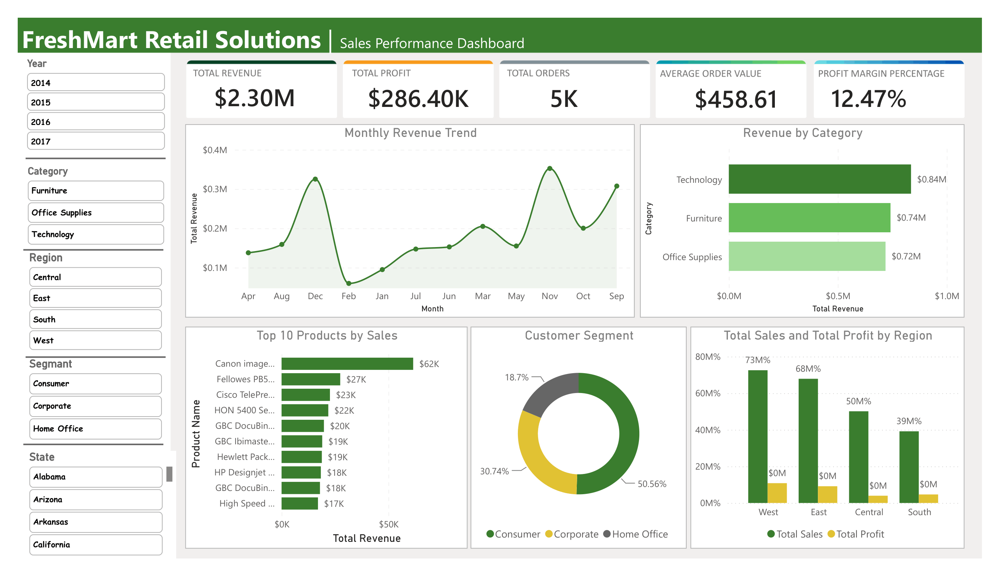
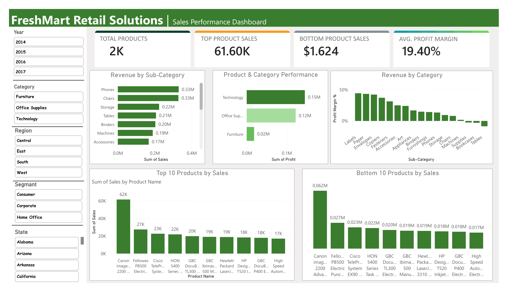
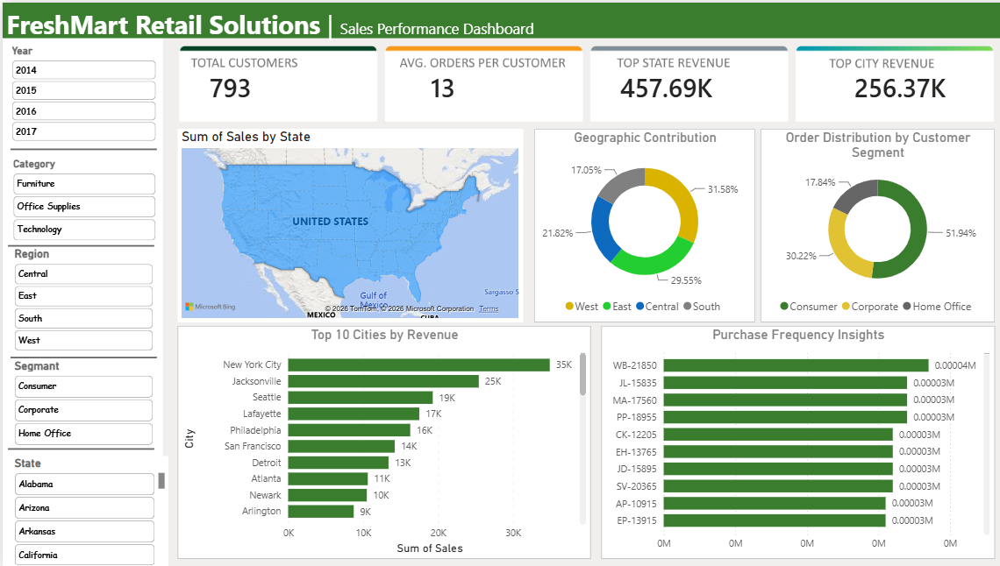

# FreshMart Retail Solutions: Sales Performance Dashboard

**Tools:** Power BI, Power Query, DAX
**Data:** Retail sales sample dataset, 9,994 transactions, 2014 to 2017

An interactive three-page Power BI dashboard for a retail chain. I cleaned and transformed the raw sales data in Power Query, wrote the DAX measures behind every KPI, and designed three linked pages for performance trends, product insights and customer segmentation.

## Headline KPIs

| Total revenue | Total profit | Total orders | Avg. order value | Profit margin |
| --- | --- | --- | --- | --- |
| $2.30M | $286.40K | 5K | $458.61 | 12.47% |

## Pages

### Page 1: Sales performance
KPI cards, monthly revenue trend, revenue by category, top 10 products, customer segment split and sales vs profit by region.

### Page 2: Product insights
Revenue by sub-category, profit by category, profit margin by sub-category, and top and bottom 10 products by sales.

### Page 3: Customer and geography
Customers, orders per customer, sales by state map, geographic contribution, order distribution by segment, top cities and purchase frequency.

All pages share slicers for Year, Category, Region, Segment and State.

## What I did

1. Cleaned and shaped the raw data in **Power Query** (types, dates, duplicates, category fields).
2. Built a star-schema style model with dimension tables for products, customers and regions.
3. Wrote **DAX measures** for revenue, profit, profit margin %, orders, average order value, customers and orders per customer.
4. Designed a consistent green layout with KPI cards, linked slicers and drill-down charts.

## Insights report

I also wrote a PDF summarising the findings: [FreshMart_Insights_Report.pdf](FreshMart_Insights_Report.pdf)

Key findings:
- Revenue rose from $484K in 2014 to $733K in 2017, with a 20.4% jump in 2017.
- Technology (17.4% margin) and Office Supplies (17.0%) drive profit. Furniture earns only a 2.5% margin.
- Tables (-$17.7K) and Bookcases (-$3.5K) lose money. Orders discounted 30% or more lose $97 per order on average.
- West and East bring in 61% of revenue. Central has the weakest margin (7.9%).
- Consumer is 50.6% of revenue, while Corporate and Home Office have slightly better margins.

## Files

| File | Description |
| --- | --- |
| `screenshots/` | Dashboard page screenshots |
| `FreshMart_Insights_Report.pdf` | Written insights and recommendations |
| `FreshMart_Dashboard.pbix` | Power BI file (add your own file here) |
